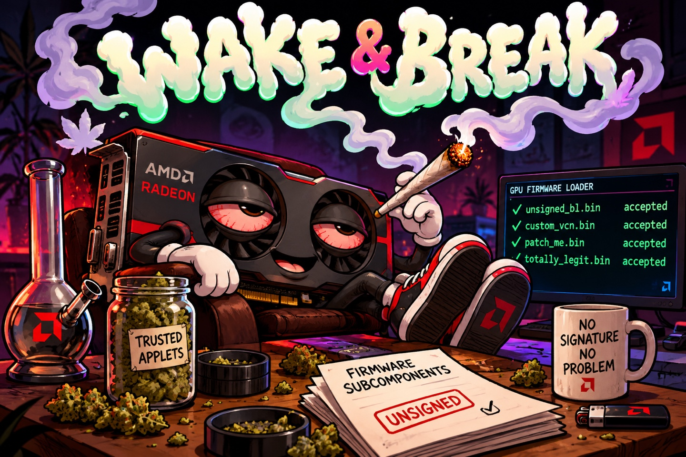

<p align="center">
  
</p>

# Wake and Break

A PSP (Platform Security Processor) exploit for AMD **navi31** cards (RX 7900 series).
Likely adaptable to other adjacent product families as well.

It turns off the PSP's firmware signature check, so the card will load
**unsigned IP firmware** (SMU, SDMA, MEC, IMU, RLC) that it would otherwise
refuse. Think custom power management, clock limits, or anything else that
lives in firmware the vendor signs and you don't.

Nothing is flashed. The patch lives in PSP memory and is applied during a warm
boot; **a cold power cycle wipes it and the card is stock again**. That warm
boot is the "Wake and Break": the card wakes up, we convince it to get **really
high** right away and coerce it into neutering signature checks. :-)

Card-tested on a RX 7900 XTX. See [Status](#status).

## What you get

```sh
python3 wakebreak.py 25=/path/to/firmware.bin
```

That plants the patch, warm-boots the card, and submits your image as firmware
type 25. If it prints `accepted`, the PSP took an image it would normally have
rejected.

Need something to try it with? `ipfw_images.py` lists the firmware your driver
actually loads and writes a test pair — a genuine image and a copy with one bit
flipped in its signature, so the firmware itself is byte-for-byte identical:

```sh
python3 ipfw_images.py             # what does this card load?
python3 ipfw_images.py 25          # -> /tmp/fw_25_{ok,bad}.bin
python3 wakebreak.py 25=/tmp/fw_25_bad.bin
```

Stock firmware rejects `fw_25_bad.bin`. With the patch in place it is accepted.
That is the whole demonstration.

## Setup

```sh
python3 -m venv venv
venv/bin/pip install -r requirements.txt
make verify          # are the shipped artifacts intact?
make selftest        # offline sanity checks, no card touched
```

You need a Linux host with the card reachable through
[tinygrad](https://github.com/tinygrad/tinygrad)'s AMD driver (PCIe or its USB
bridge). See `requirements.txt` for one tinygrad patch your host needs.

## Which card do you have?

There are four known navi31 firmware builds, and the patch has to match.
Profile `a` is the default and covers the most common one. If you have a dump
of your card's SPI flash, `identify.py` will tell you:

```sh
python3 identify.py FLASH.bin
# -> sos-build c: wakebreak.py --sos-build c
```

Otherwise just try them. **Guessing wrong is harmless:** the patch checks what
it is about to modify, finds something it does not recognise, writes nothing,
and the card boots normally.

```sh
python3 wakebreak.py --sos-build c 25=/tmp/fw_25_bad.bin
```

## Status

Confirmed on two different cards and firmware builds:

|                               | profile `a`    | profile `c`    |
| ----------------------------- | -------------- | -------------- |
| tampered firmware, stock card | rejected       | rejected       |
| tampered firmware, patched    | **accepted**   | **accepted**   |
| after cold power cycle        | rejected again | rejected again |

Profile `a` was tested on an RX 7900 XTX behind a USB bridge, profile `c` on a
TinyBox RX 7900 XTX over native PCIe.

**NOTE**: Profiles `b` and `d` are built and checked offline but have never run on hardware. If you have a card that matches profile `b` or `d` please report back if it works!

### If your card is natively attached

A card whose PSP dies during the warm boot can hang the **whole host** — no
kernel log, no MCE, and recovery is a BMC power cycle. Behind a USB bridge the
same failure only costs the card. Don't run this on a machine you cannot power
cycle.

## Rebuilding

The patch itself is a few hundred bytes of ARM assembly, in `hook/*.S`. The
built blobs ship with the repo, so you don't need a cross compiler to use this.
If you want to rebuild them anyway:

```sh
make rebuild                                  # needs arm-none-eabi binutils
make rebuild CROSS=/path/to/arm-none-eabi-
```

The build refuses to install anything whose hash doesn't match the bytes that
were tested on a card, so a different toolchain cannot quietly change what gets
written to your PSP.

## What's in here

```
wakebreak.py        the exploit
identify.py       which --sos-build does this card need?
ipfw_images.py    build a signed/tampered firmware pair to test with
selftest.py       offline checks
hook/             the patch: ARM sources and built blobs
firmware/         two stock AMD firmware images the exploit needs to get in
```

`firmware/` holds unmodified, publicly shipped AMD images. They are old
versions, kept because the way in runs through them.

## How it works

Not covered here on purpose: read the code. `wakebreak.py` is ~600 commented
lines and the comments explain the mechanism, the safety checks and why each
step is ordered the way it is. **TL;DR:** two stock AMD trusted
applications are loaded, one of them is talked into running a chain that can
write PSP memory, the patch is placed in the bootloader's resident copy, and
then the card is warm-booted into it.

## License

MIT, see `LICENSE`. Do what you like with it.

## DISCLAIMER

Heavy LLM assistance was used in producing this piece of work. That doesn't
mean the author has no clue of what's actually going on here. _a lot_ of
push back and manual work was involved to even get to this point. You might
not like the slopped python artifacts or whatever, but you won't be able
to argue with the fact your Navi31 card now all of a sudden loads unsigned
firmware component blobs. Thank you for your attention.
